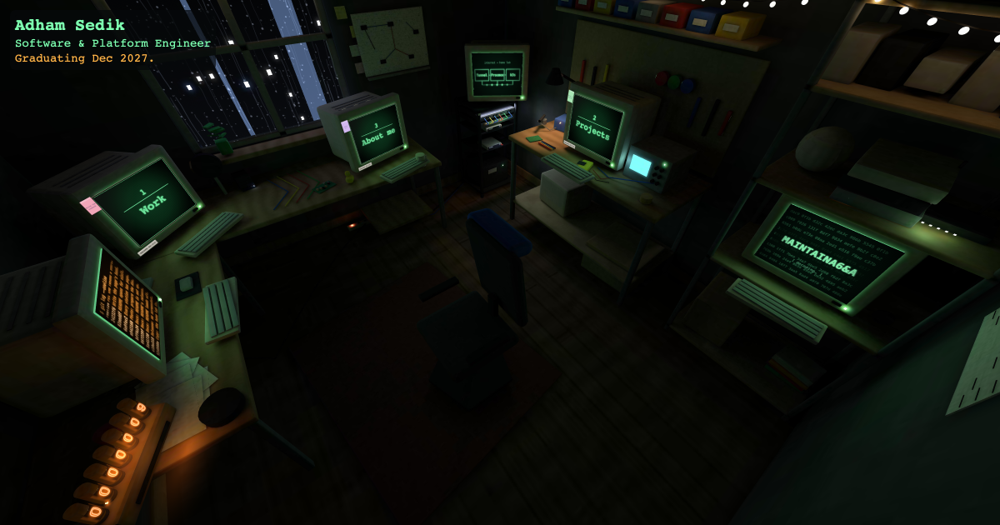

# Lab

**A portfolio you walk through: a 3D late-night home lab where each lit monitor is a stop on the tour.**

**[Visit the live site](https://lab.mediasafe.space)** · **[Résumé (PDF)](public/resume.pdf)**

[](https://lab.mediasafe.space)

You open on an overview of a desk with three lit monitors. Click one (or a link at the top) and the camera flies to
it. Each monitor has pages you step through: work experience, projects (Software factory, MediaSafe, Home lab) and
About me. Three spare CRTs stay lit and are decoration. A
nixie-tube meter on the desk shows a live number: how many MediaSafe staging deploys have landed since the last
promotion to production.

I'm Adham Sedik, a software and platform engineer. This repo is the site's full source, and an AI software factory
I run built it.

> This GitHub repo is a read-only mirror of `main`. Pull requests, reviews and CI run on my self-hosted
> Forgejo, so you won't see them here, but every commit is.

## Highlights

- **The room is made from code.** A Python script ([`tools/room/build.py`](tools/room/build.py)) builds every object from primitives in headless Blender and bakes
  the lighting into textures, so the scene is reproducible and reviewable in a diff.
- **It works on phones.** Phones get the same scene as desktop. Textures ship at 2048 px to fit phone GPU memory,
  and every build fails if the first screen goes over about 100 KB or the whole site over 15 MB (gzip).
- **Live data, no backend.** The meter's count comes from a public GitOps repo's commit history, read by the
  visitor's browser through the GitHub API. The site stays static files served by nginx. If the call fails, the
  meter falls back to a value saved at build time and says the reading isn't live. The build also reads the site's latest
  commits from the same API.
- **Text is real HTML.** Station text is HTML pinned to the screens, and the page carries it before boot, so search engines can read
  it. The tour works from the keyboard (arrow keys and Esc), respects reduced motion, and shows a failure
  screen when 3D can't start.
- **Built and shipped by agents, with tests at every step.** 100+ merged pull requests since 5 November 2026, each
  written test-first and reviewed before merge. More below.

## How it was built

An AI software factory built this site:

1. I plan a feature with an orchestrator agent, which cuts it into small tickets.
2. Builder agents write each ticket test-first in their own git worktree and open a pull request.
3. CI runs the unit and integration tests and takes screenshots of every station, on every PR. It runs no browser specs.
4. A fresh reviewer agent decides whether the PR merges by itself, needs me, or goes back for a rebuild.
5. The timing and rendering specs run before each deploy to staging. I promote to production by hand.

## How it ships

```
pull request ──► CI ──► merge to main ──► release: timing and rendering specs ──► staging ──► (by hand) production
```

- **CI** (Forgejo Actions on my own runner): type check, unit tests, the production build with its size budget,
  an integration test, station screenshots, a gitleaks secret scan, and `make facts`, which fails if a doc names a
  path, command or test tag that no longer exists.
- **Release:** after each merge, the timing and rendering specs run, with WebGL drawn in software on a runner with no GPU.
  Staging moves only if they pass. The other browser specs run on main once staging has moved. A failure there is found and fixed after the merge, since PR CI runs no browser specs.
- **Hosting:** a Docker image, deployed by Argo CD from the Helm chart in [`deploy/`](deploy) to a single-node k3s cluster on
  a Proxmox host at home. Traffic comes in through a Cloudflare Tunnel, so no ports are open.

## Stack

| Area | Tools |
|---|---|
| Site | TypeScript, React, React Three Fiber, three.js, Vite |
| 3D assets | Blender (Python scripts), baked lighting, glTF |
| Tests | Vitest (unit), Playwright (browser), a Node integration test |
| Delivery | Forgejo Actions, Docker, nginx, Helm, Argo CD, k3s |

## Repo map

| Path | What's there |
|---|---|
| [`src/`](src) | The site: the room, the tour, the HUD and the meter, with unit tests beside the code |
| [`tests/`](tests) | Playwright browser specs and the integration test |
| [`tools/`](tools) | Scripts that make the committed assets: the room, the meter's images, the About me photo, the preview image and the favicon |
| [`deploy/`](deploy) | The Helm chart and values that Argo CD runs |
| [`.forgejo/workflows/`](.forgejo/workflows) | CI, release and promotion pipelines |
| [`docs/adr/`](docs/adr) | Architecture decisions, one file each |
| [`CONTEXT.md`](CONTEXT.md) | The project's terms and the rules behind them |

## Run it

You need Node 22 (the Dockerfile uses it) and npm.

```
npm ci
npm run dev
```

`npm test` runs the unit tests. `npm run build` saves today's live gap and the latest commits, type-checks, makes the production build and
checks the size budget. `make frontend` runs `npm ci`, the type check, `npm test` and `npm run build`, in that order.
`make facts` checks that the paths, commands and tags the docs name exist. The room's 3D model is committed, so you
don't need Blender unless you rebuild it (below).

## Rebuilding the committed assets

The room, the meter's images, the About me photo, the résumé, the preview image and the favicon are all made by scripts and committed
(ADR-0004, ADR-0006). CI never makes them, so you only need these when you change one on purpose. The notes below
are for whoever maintains the site.

<details>
<summary>The room</summary>

`make room` runs `tools/room/build.py` in headless Blender (5.x) and rewrites `src/assets/room.glb`.
The room is modelled from primitives in that script and lit only by things in it (CRTs, the nixie
meter, LEDs, a bench lamp, fairy lights, the city through the window). Each of three atlases (walls,
furniture, props) is baked as sharp surface colour at 4096 px, plus lighting at 2048 px (1024 for the
walls) with 192 samples. The Makefile then runs `tools/room/resize.py`, which shrinks the atlases to
2048 px, so the site ships 2048 px textures: three 4096 px ones need too much GPU memory for phones. The lighting is lightly blurred to remove noise, because this Blender build
has no denoiser. The output is committed (ADR-0004), so re-bake on purpose.

Where each CRT sits is in `src/room-layout.json`, which the script and the site both read. The file
also holds the overview and the pulled-back portrait (phone) views. The desktop stops are
not in it: `src/stop.ts` works them out from each CRT's place and the window. To check composition
without baking, run `blender -b -P tools/room/build.py -- --preview /tmp/shots` to render a camera
view of each of the six TVs (the three stations, the bench TV among them, and the three spare CRTs; all six are lit, and only the stations carry a sticky note) and of the overview at 16:9 and 16:10 (the desktop stops are not among them). For a quick
test bake, pass `--size 1024 --light-size 512 --samples 64` after `--`. Draco mesh compression isn't
used, because this Blender build lacks the library.

</details>

<details>
<summary>The meter bar's images</summary>

`make meter` renders the meter bar's images: a walnut case with seven glass nixie tubes and legend keys, drawn as
layers (the unlit device, the tubes' light on the case, ten lit numerals, the decimal point and four keys). It
serves `tools/meter/` through Vite and opens it in Playwright's Chromium, which has WebGL, so no CDN is fetched,
and writes the layers to `src/assets/meter/`. Run it on the Mac, through `heavy`: `heavy make meter`. The wood
grain uses a fixed seed, so rendering again at the same commit writes the same files. `src/meter-layers.ts` lists
the layers with their places and sizes on the 840 px wide device. The key words come from `src/content.ts`, so a
change to one means rendering again. The images are committed (ADR-0006), and CI never runs it.

</details>

<details>
<summary>The About me photo and other page images</summary>

`make photo SRC=<image> PREVIEW=<png>` runs `tools/photo/make.py` and writes `src/assets/adham.jpg`. The source is any image Pillow reads (a PNG or a JPEG). `PREVIEW` is optional: it also writes a phosphor-green copy with scanlines, for looking at the result, and that copy is not committed. The script crops the source to head and shoulders, makes it greyscale, stretches the contrast (the darkest point goes to black, the lightest to white), darkens the edges so the face is the brightest part, scales it to 600 px tall and writes a JPEG with no EXIF, XMP, IPTC or comment.

For any other page image, add `OUT`, `WIDTH` and `CAP`: `make photo SRC=<image> OUT=<name.jpg> WIDTH=<px> CAP=<KB> CROP=<left,top,right,bottom>`. It writes `src/assets/<name.jpg>`: greyscale with the same contrast step, no darkened edges, never scaled up and no wider than `WIDTH`, and no metadata. It lowers the JPEG quality from 78 until the file is within `CAP`, and fails, saying so, if it can't by quality 50. `CROP` is optional and keeps only that box of the source, in the source's pixels.

The MediaSafe page's screenshot (`src/assets/mediasafe-library.jpg`) is the first three titles of the Library's first row, from a 2000×1230 capture: `make photo SRC=<capture> OUT=mediasafe-library.jpg WIDTH=1400 CAP=200 CROP=325,205,1297,745`. Look at the result before committing it: no sidebar, account name, avatar or email may show.

It needs Python 3 with Pillow. Run it on the Mac. The source stays on the Mac and is never committed: a photo carries the camera model and the date taken. The output is committed, and CI never runs it. `src/photo-metadata.test.ts` checks, for each page image in its table, that the committed file exists, has no metadata, is greyscale and is within its width or height and size cap.

</details>

<details>
<summary>The résumé</summary>

`make resume` builds `public/resume.pdf` from `resume/resume.tex` with [tectonic](https://tectonic-typesetting.github.io/). Run it on the Mac: the first run downloads a TeX bundle, so it needs the network. The PDF is committed, and CI never runs it. The résumé must stay one page: check with `pdfinfo public/resume.pdf`, which shows `Pages: 1`. If the text spills, tighten spacing (margins, gaps between sections) before changing words. The source holds no phone number, and `src/resume.test.ts` checks that.

</details>

<details>
<summary>The preview image</summary>

`make og-image` writes `public/og-image.png`, the picture a shared link shows (1200×630). Run it on the Mac, through `heavy`: `heavy make og-image`. It builds the site, serves it with `npm run preview`, opens it in Playwright's Chromium at a 1200×630 window with device scale factor 2, waits for the boot screen to go, the camera to be still at the overview and the desk meter's reading to settle, hides the HUD's link row, the numbered pins, the Start button and the meter bar for the shot only, and scales the shot to 1200×630 in a browser canvas. The desk meter stays in the shot and shows whatever gap it read. The PNG is committed, and CI never runs it. `src/page-image-tags.test.ts` checks the file's size matches the head's `og:image:width` and `og:image:height`. The desk meter stays in the shot. If the room or the overview changes, run it again and look at the image.

</details>

<details>
<summary>The favicon</summary>

`make favicon` writes `public/favicon.png` (48×48) and `public/apple-touch-icon.png` (180×180), the lit nixie "0" on the tab. Run it on the Mac, through `heavy`: `heavy make favicon`. In a browser canvas it paints `#05080a`, the meter's base image, then the light and the "0" numeral at the first tube's place (both additive), clips out the next tube and crops two squares: the 48 px favicon close on the lit numeral (the "0" and its glow fill the square, with a little dark margin), and the 180 px touch icon on the whole first tube (the glass fills its height). The two icons are cropped differently, so the tab shows a readable "0" and the home screen shows the tube. The sides stay `#05080a`. Run it again after `make meter`, since the icons come from the meter's committed images. The PNGs are committed, and CI never runs it. `src/page-icon-tags.test.ts` checks their sizes from the PNG headers. The first-screen budget doesn't count the icon links.

</details>
